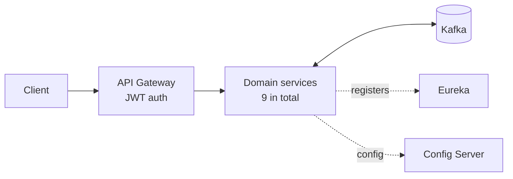

<!-- README.md -->

<picture>
  <source media="(prefers-color-scheme: dark)" srcset="assets/hero-dark.svg">
  <source media="(prefers-color-scheme: light)" srcset="assets/hero-light.svg">
  
</picture>

  
  
  
  
  

I build non-blocking microservices with **Spring WebFlux**, **Kafka** and **Neo4j** at **Dhrubok Infotech Service Ltd**. I care about event-driven architecture, clean API contracts, and code that keeps working under load.

<picture>
  <source media="(prefers-color-scheme: dark)" srcset="assets/stack-dark.svg">
  <source media="(prefers-color-scheme: light)" srcset="assets/stack-light.svg">
  
</picture>

## Selected work

### [Quickart](https://github.com/SKgain/quickart-backend)
E-commerce backend split into 9 independently deployable services, with JWT auth at the gateway and Kafka between services.
 Java 21, Spring Cloud, Kafka, Neo4j, Eureka, Config Server

Architecture

### [TaskMaster](https://github.com/SKgain/taskmaster-backend)
Project management backend with role-based access, real-time WebSocket chat, Gemini-generated tasks and analytics dashboards.
 Java 21, Spring Boot, PostgreSQL, Docker

### [BanglaBERT Semantic Similarity API](https://github.com/SKgain/semantic-similarity-backend)
My thesis: Spring Boot serves a fine-tuned BanglaBERT model that rates Bangla sentence pairs as high, moderate or low similarity.
 Java, Spring Boot, Python, Docker

## Publications

| Paper | Venue |
|---|---|
| Ancient Bengal Numismatic Dataset of Vanga Janapada, Gauda, Samatata, and Harikela Coinage | Q1 journal |
| Bangla Semantic Analysis Using a Transformer-Based BanglaBERT Model | Conference |
| Explainable Stacking Machine Learning Ensemble Model for Liver Disease Prediction | Conference |
| Stroke Prediction Using Ensemble Machine and Deep Learning Models | Q2 journal |

## Everything, connected

<picture>
  <source media="(prefers-color-scheme: dark)" srcset="assets/graph-dark.svg">
  <source media="(prefers-color-scheme: light)" srcset="assets/graph-light.svg">
  
</picture>

BSc in Computer Science and Engineering, IUBAT. Based in Dhaka, Bangladesh. Reach me at saikatgain.cse@gmail.com.
